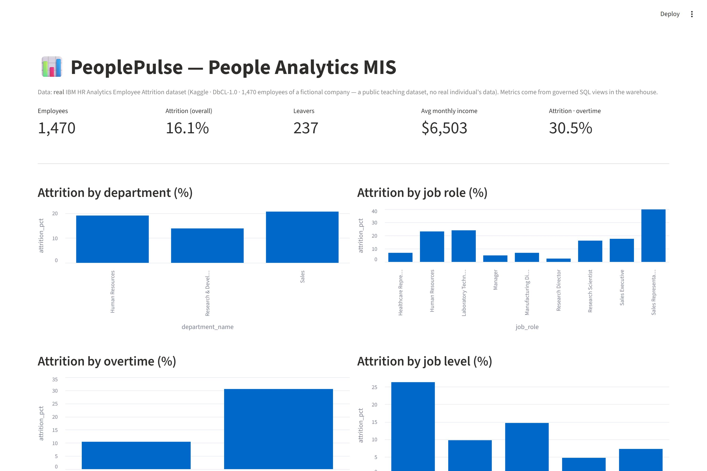
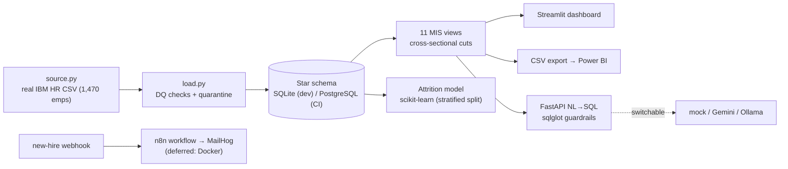

# PeoplePulse 📊

**People-analytics MIS + a guard-railed Generative-AI HR query assistant +
low-code onboarding automation — over the real IBM HR Attrition dataset.**

PeoplePulse turns a real, public HR dataset into a governed star-schema
warehouse, serves an executive MIS dashboard, predicts attrition risk, answers
plain-English HR questions by generating **validated** SQL, and automates
new-hire onboarding with a low-code workflow. It covers the full HR-Tech stack:
**people analytics, MIS dashboards, Generative AI, low-code/no-code, and data
governance.**

> ✅ **Data is real and public:** the
> [IBM HR Analytics Employee Attrition & Performance](https://www.kaggle.com/datasets/pavansubhasht/ibm-hr-analytics-attrition-dataset)
> dataset (Kaggle, License **DbCL-1.0**) — 1,470 employees of a *fictional*
> company, published by IBM data scientists as a teaching dataset. It contains
> **no real individual's data**, and PeoplePulse adds nothing of its own: every
> field is a column of the published CSV. The attrition outcome (~16%) and all
> metrics below come from that data.



## The data is cross-sectional

The IBM dataset is a **single snapshot**: one row per employee with an
`Attrition` (Yes/No) outcome, and no hire/exit dates, no monthly history, and a
single company/location. PeoplePulse therefore models exactly what the data
contains — **cross-sectional** attrition analytics and a prediction model — and
deliberately does **not** present time-series headcount, rolling attrition, a
hiring funnel, time-to-hire, or multi-country views (there is no public HRIS
dataset with real dated events — that data is PII and is not published). This is
a change from an earlier synthetic version of the project, made so that every
number shown is real rather than generated.

## Architecture



## What it demonstrates (mapped to the JD)

| JD theme | In this repo |
|---|---|
| People analytics & MIS | Star schema + 11 SQL views: attrition by department, job role, overtime, job level, tenure band, income band, age band; pay and diversity cuts |
| Dashboards | Streamlit app + documented Power BI model with DAX ([docs/POWERBI.md](docs/POWERBI.md)) |
| Generative AI | NL→SQL assistant with read-only guardrails, sqlglot validation, allow-listed views, PII refusals |
| Predictive analytics | Attrition-risk model (logistic reg + gradient boosting) vs a majority baseline, stratified hold-out |
| Low-code / no-code | n8n onboarding workflow (webhook → tasks → templated email) |
| Data governance | Real DQ checks + row quarantine, read-only DB role, SQL allow-list, no individual-level data exposed |

## Real metrics

From actual runs (`python -m scripts.collect_metrics`, written to
[metrics.json](metrics.json)):

| Metric | Value |
|---|---|
| Employees loaded / quarantined | 1,470 / **0** (clean published source; DQ rules proven by unit tests) |
| Leavers (attrition) | **237** (16.1%) |
| Dimensions / facts / MIS views | 3 dims + `dim_employee` / 1 fact / **11 views** |
| Attrition model — ROC-AUC (logreg) vs baseline F1 | **0.82** vs 0.00 baseline F1 |
| Attrition model — precision / recall / F1 (logreg) | 0.41 / **0.64** / 0.50 |
| Strongest drivers (gradient boosting) | overtime, stock-option level, monthly income, job satisfaction, age, job level |
| NL→SQL exact-match accuracy (15 questions) | **100%** (rule-based mock) |
| Guardrail block-rate (10 adversarial prompts) | **100%** |
| Automated tests | **36** (pytest, green on PostgreSQL in CI) |

## Quickstart

```powershell
python -m venv .venv
.venv\Scripts\python.exe -m pip install -r requirements.txt

# Data: the IBM HR CSV is read from data/raw/. To (re)download it you need a
# Kaggle API token; see https://www.kaggle.com/docs/api
.venv\Scripts\python.exe -m peoplepulse.data.source

# 1. Build the warehouse: ingest → load (DQ) → MIS views
.venv\Scripts\python.exe -m peoplepulse.pipeline

# 2. Train the attrition model (writes data_out/model_metrics.json)
.venv\Scripts\python.exe -m peoplepulse.model.train

# 3. Evaluate the GenAI assistant (15 questions + 10 adversarial prompts)
.venv\Scripts\python.exe -m eval.run_eval

# 4. Dashboard  →  http://localhost:8501
.venv\Scripts\python.exe -m streamlit run peoplepulse/dashboard/app.py --server.port 8501

# 5. GenAI API  →  http://localhost:8002/docs
.venv\Scripts\python.exe -m uvicorn peoplepulse.api.main:app --port 8002
```

Ask the API a question:

```powershell
curl.exe -X POST http://localhost:8002/query -H "Content-Type: application/json" `
  --data '{"question":"What is the attrition rate for employees working overtime?"}'
```

### Database backends

Local dev uses **SQLite** (`pgserver` has no Windows wheel, and we avoid a
system Postgres install). **CI runs the identical schema and views on real
PostgreSQL 16** via a service container. The SQL is kept dialect-portable
(`CASE`-based bands, no 2-arg `ROUND` on floats, `NULLIF`-guarded float
division), and every view is also parsed as PostgreSQL in the tests. Point at
Postgres by setting `DATABASE_URL` (see [.env.example](.env.example)).

## The GenAI guardrails (data governance)

The assistant never trusts generated SQL. Before anything runs,
[`api/guardrails.py`](peoplepulse/api/guardrails.py) enforces:

1. it **parses** (sqlglot) and is **exactly one statement**;
2. the root is a **SELECT** — any write/DDL/command node is rejected;
3. every table is on the **allow-list of MIS views** (so `dim_employee` and
   other individual-level tables are unreachable);
4. a **row limit** is enforced.

On top of that, [`api/nl2sql.py`](peoplepulse/api/nl2sql.py) refuses
**individual/PII** questions and injection/write attempts up front, and executes
on a **read-only** connection. The LLM provider is switchable (`mock` default,
`gemini`, `ollama`) via `LLM_PROVIDER` — tests and CI stay hermetic on the mock.

## Attrition-risk model

Because the data is cross-sectional (no dates to split on), the model uses a
**stratified hold-out** (75/25, fixed seed) that preserves the ~16% attrition
base rate in both folds — the canonical way this public dataset is modelled.
Logistic regression and gradient boosting both beat a majority-class baseline;
the strongest drivers the models recover are **overtime, monthly income,
stock-option level, job satisfaction, age and job level** — well-known real
signals in this dataset. See
[`peoplepulse/model/train.py`](peoplepulse/model/train.py).

## Low-code onboarding (n8n) — ⚠️ live run deferred

The n8n workflow is authored and exported to
[`automation/n8n_onboarding_workflow.json`](automation/n8n_onboarding_workflow.json)
and documented in [automation/README.md](automation/README.md). n8n + MailHog are
Docker-only; Docker is not available in this build, so the **live run and its
screenshots are deferred** (nothing is fabricated). CI skips this step.

## Project layout

```
peoplepulse/
  data/source.py          read the real IBM HR CSV (no fabrication)
  warehouse/              schema.py, load.py (ETL), quality.py (DQ), export.py
  mis/                    views.sql (+ build_views.py)
  model/train.py          attrition model (sklearn, stratified split)
  api/                    guardrails.py, providers.py, nl2sql.py, main.py (FastAPI)
  dashboard/app.py        Streamlit MIS
  pipeline.py             ingest → load → views
data/raw/                 the real IBM HR CSV (DbCL-1.0)
eval/                     15 questions + 10 adversarial prompts + runner
automation/               n8n workflow JSON + docs
tests/                    pytest suite
docs/POWERBI.md           Power BI build guide + DAX
.github/workflows/ci.yml  ruff + pytest on PostgreSQL
```

## Testing & CI

```powershell
.venv\Scripts\python.exe -m ruff check .
.venv\Scripts\python.exe -m pytest
```

CI (`.github/workflows/ci.yml`) runs ruff + the full suite against a real
PostgreSQL 16 service, with the LLM mocked.

---

*See [INTERVIEW_NOTES.md](INTERVIEW_NOTES.md) for a Q&A walkthrough and
[RESUME_BULLETS.md](RESUME_BULLETS.md) for résumé lines.*
