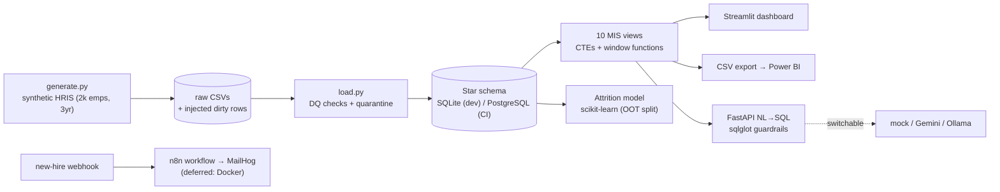

# PeoplePulse 📊

**People-analytics MIS + a guard-railed Generative-AI HR query assistant +
low-code onboarding automation — over SYNTHETIC HRIS data.**

PeoplePulse turns a messy synthetic HRIS feed into a governed star-schema
warehouse, serves executive MIS dashboards, predicts attrition risk, answers
plain-English HR questions by generating **validated** SQL, and automates new-hire
onboarding with a low-code workflow. It covers the full HR-Tech stack: **people
analytics, MIS dashboards, Generative AI, low-code/no-code, and data governance.**

> ⚠️ **All data is SYNTHETIC** — randomly generated by
> [`peoplepulse/data/generate.py`](peoplepulse/data/generate.py). No real
> employee, compensation, or applicant data is used anywhere.


## Architecture



## What it demonstrates (mapped to the JD)

| JD theme | In this repo |
|---|---|
| People analytics & MIS | Star schema + 10 SQL views: headcount, attrition (monthly + rolling 12m), tenure, time-to-hire, offer acceptance, diversity |
| Dashboards | Streamlit app + documented Power BI model with DAX ([docs/POWERBI.md](docs/POWERBI.md)) |
| Generative AI | NL→SQL assistant with read-only guardrails, sqlglot validation, allow-listed views, PII refusals |
| Predictive analytics | Attrition-risk model (logistic reg + gradient boosting) vs a majority baseline, out-of-time split |
| Low-code / no-code | n8n onboarding workflow (webhook → tasks → templated email) |
| Data governance | DQ checks + row quarantine, read-only DB role, SQL allow-list, SYNTHETIC-only data |

## Real metrics

From actual runs (`python -m scripts.collect_metrics`, written to
[metrics.json](metrics.json)):

| Metric | Value |
|---|---|
| Employees generated / quarantined | 2,008 / **8** (duplicate, null, bad-date, exit-before-hire, unknown-country) |
| MIS views (over 4 dims, 3 facts) | **10** |
| Fact rows (headcount / exits) | 8,157 / 591 |
| Attrition model — ROC-AUC (logreg vs baseline F1) | **0.63** vs 0.00 baseline F1 |
| Attrition model — precision / recall / F1 (logreg) | 0.24 / 0.56 / 0.33 |
| NL→SQL exact-match accuracy (25 questions) | **100%** (rule-based mock) |
| Guardrail block-rate (10 adversarial prompts) | **100%** |
| Automated tests | **34** (pytest, green on PostgreSQL in CI) |

## Quickstart

```powershell
python -m venv .venv
.venv\Scripts\python.exe -m pip install -r requirements.txt

# 1. Build the warehouse: generate → load (DQ) → MIS views
.venv\Scripts\python.exe -m peoplepulse.pipeline

# 2. Train the attrition model (writes data_out/model_metrics.json)
.venv\Scripts\python.exe -m peoplepulse.model.train

# 3. Evaluate the GenAI assistant (25 questions + 10 adversarial prompts)
.venv\Scripts\python.exe -m eval.run_eval

# 4. Dashboard  →  http://localhost:8501
.venv\Scripts\python.exe -m streamlit run peoplepulse/dashboard/app.py --server.port 8501

# 5. GenAI API  →  http://localhost:8002/docs
.venv\Scripts\python.exe -m uvicorn peoplepulse.api.main:app --port 8002
```

Ask the API a question:

```powershell
curl.exe -X POST http://localhost:8002/query -H "Content-Type: application/json" `
  --data '{"question":"What was attrition in UAE engineering in 2025?"}'
```

### Database backends

Local dev uses **SQLite** (`pgserver` has no Windows wheel, and we avoid a
system Postgres install). **CI runs the identical schema and views on real
PostgreSQL 16** via a service container. The SQL is kept dialect-portable (date
parts precomputed in `dim_date`, no 2-arg `ROUND` on floats, `NULLIF`-guarded
float division), and every view is also parsed as PostgreSQL in the tests. Point
at Postgres by setting `DATABASE_URL` (see [.env.example](.env.example)).

## The GenAI guardrails (data governance)

The assistant never trusts generated SQL. Before anything runs,
[`api/guardrails.py`](peoplepulse/api/guardrails.py) enforces:

1. it **parses** (sqlglot) and is **exactly one statement**;
2. the root is a **SELECT** — any write/DDL/command node is rejected;
3. every table is on the **allow-list of MIS views** (so `dim_employee` and
   other individual-level tables are unreachable);
4. a **row limit** is enforced.

On top of that, [`api/nl2sql.py`](peoplepulse/api/nl2sql.py) refuses
**individual/PII** questions and injection/write attempts up front, and executes
on a **read-only** connection. The LLM provider is switchable (`mock` default,
`gemini`, `ollama`) via `LLM_PROVIDER` — tests and CI stay hermetic on the mock.

## Attrition-risk model

An **out-of-time** split (train as-of 2023-12-31 → label = left in 2024; test
as-of 2024-12-31 → label = left in 2025) avoids leakage. Logistic regression and
gradient boosting both beat a majority-class baseline; the strongest drivers the
model recovers are **compensation ratio** and **department** — the exact signals
built into the synthetic hazard. See
[`peoplepulse/model/train.py`](peoplepulse/model/train.py).

## Low-code onboarding (n8n) — ⚠️ live run deferred

The n8n workflow is authored and exported to
[`automation/n8n_onboarding_workflow.json`](automation/n8n_onboarding_workflow.json)
and documented in [automation/README.md](automation/README.md). n8n + MailHog are
Docker-only; Docker is not available in this build, so the **live run and its
screenshots are deferred** (nothing is fabricated). CI skips this step.

## Project layout

```
peoplepulse/
  data/generate.py        synthetic HRIS + injected dirty rows
  warehouse/              schema.py, load.py (ETL), quality.py (DQ), export.py
  mis/                    views.sql (+ build_views.py)
  model/train.py          attrition model (sklearn)
  api/                    guardrails.py, providers.py, nl2sql.py, main.py (FastAPI)
  dashboard/app.py        Streamlit MIS
  pipeline.py             generate → load → views
eval/                     25 questions + 10 adversarial prompts + runner
automation/               n8n workflow JSON + docs
tests/                    34 pytest tests
docs/POWERBI.md           Power BI build guide + DAX
.github/workflows/ci.yml  ruff + pytest on PostgreSQL
```

## Testing & CI

```powershell
.venv\Scripts\python.exe -m ruff check .
.venv\Scripts\python.exe -m pytest
```

CI (`.github/workflows/ci.yml`) runs ruff + the full suite against a real
PostgreSQL 16 service, with the LLM mocked.

---

*See [INTERVIEW_NOTES.md](INTERVIEW_NOTES.md) for a Q&A walkthrough and
[RESUME_BULLETS.md](RESUME_BULLETS.md) for résumé lines.*
