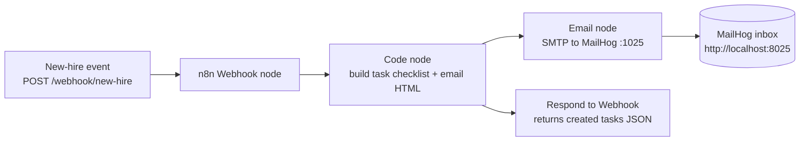

# Low-code onboarding automation (n8n + MailHog)

A new-hire **webhook** triggers an [n8n](https://n8n.io) workflow that builds a
department-specific onboarding checklist and emails a templated welcome message
to the new joiner. The email is captured by **MailHog** (a local fake SMTP
inbox) — nothing leaves the machine.

> ## ⚠️ Live run requires Docker — **deferred**
> n8n and MailHog run as Docker containers. Docker is **not installed** in the
> build environment, so the workflow was **authored and exported** (the JSON is
> committed and validated) but **not executed live**, and there are **no
> fabricated screenshots**. The steps below run it end to end once Docker is
> available. CI skips this step.

## Data flow



**Webhook payload** (JSON body):

```json
{
  "full_name": "Asha Rao",
  "email": "asha.rao@peoplepulse.local",
  "department": "Engineering",
  "country": "India",
  "start_date": "2026-01-05",
  "manager_email": "manager@peoplepulse.local"
}
```

**Response** (from the `Respond to Webhook` node):

```json
{
  "status": "onboarding_started",
  "new_hire": "Asha Rao",
  "tasks_created": 7,
  "tasks": ["Create corporate email + SSO account", "...", "Grant Git/CI access", "..."]
}
```

The `Code` node adds department-specific tasks (Engineering → Git/CI + on-call
shadow; Sales → CRM + territory; Support → helpdesk + training; Finance → ERP +
compliance) on top of the five base tasks every hire gets.

## Run it (when Docker is available)

1. **Start n8n + MailHog** (example `docker-compose.yml`):

   ```yaml
   services:
     n8n:
       image: n8nio/n8n:latest
       ports: ["5678:5678"]
       environment:
         - N8N_SECURE_COOKIE=false
     mailhog:
       image: mailhog/mailhog:latest
       ports: ["1025:1025", "8025:8025"]   # 1025 = SMTP, 8025 = web UI
   ```

   ```powershell
   docker compose up -d
   ```

2. **Import the workflow**: open http://localhost:5678 → *Workflows → Import from
   file* → select `automation/n8n_onboarding_workflow.json`.

3. **Create the SMTP credential** named exactly **`MailHog SMTP`**:
   Host `mailhog` (or `localhost`), Port `1025`, SSL/TLS **off**, no user/password.

4. **Activate** the workflow, then fire the webhook:

   ```powershell
   curl.exe -X POST http://localhost:5678/webhook/new-hire `
     -H "Content-Type: application/json" `
     --data '{"full_name":"Asha Rao","email":"asha.rao@peoplepulse.local","department":"Engineering","country":"India","start_date":"2026-01-05"}'
   ```

5. **Verify**: the curl response lists the created tasks; the welcome email
   appears in the MailHog UI at http://localhost:8025.

## Why n8n here

It demonstrates the **low-code / no-code** automation the JD calls for: an HR
event orchestrating multi-step onboarding (account creation, task assignment,
templated comms) without bespoke backend code — exactly the kind of workflow an
HR Tech team maintains.
